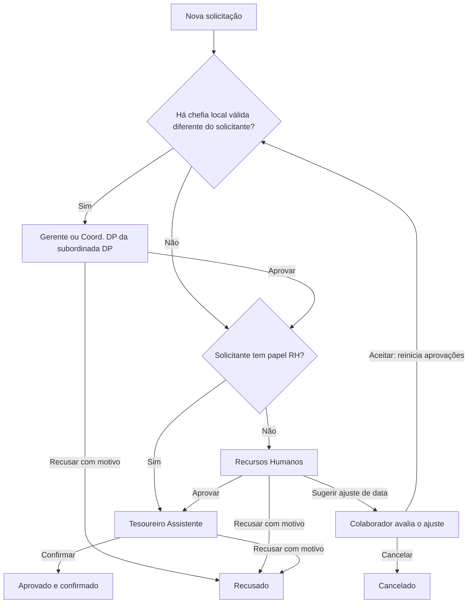

# Módulo de Férias / Folga

Solicitações de férias e folga passam pelo **Departamental / Gerente → Recursos
Humanos → Tesoureiro Assistente**. O **Coord. Departamento Pessoal** acompanha
todas as etapas e todo o histórico na visão geral. A única exceção de decisão
é a primeira etapa das férias de pessoas do Departamento Pessoal pertencentes
aos setores em que ela é a coordenadora cadastrada. Quando o solicitante é
**Recursos Humanos**, a revisão do RH é dispensada: após a chefia, o pedido
segue diretamente ao **Tesoureiro Assistente**, que confirma ou recusa.

## Fluxo de aprovação



| Etapa | Responsável | Estado no banco | Estado da visão geral | Ações |
|---|---|---|---|---|
| 1 | Gerente (`GESTOR`) ou Coord. DP da subordinada DP, conforme vínculo de chefia | `PENDENTE` | `PENDENTE` | Aprovar ou recusar com motivo |
| 2 | Recursos Humanos (`RH`), exceto quando o solicitante é RH | `APROVADO_GESTOR` | `AGUARDANDO_RH` | Aprovar, recusar com motivo ou sugerir ajuste |
| 3 | Tesoureiro Assistente (`ASSISTENTE`) | `APROVADO_RH` | `AGUARDANDO_ASSISTENTE` | Confirmar ou recusar com motivo |
| Final | Concluído | `APROVADO` | `APROVADA` | Confirmação final registrada |

A aprovação da chefia encaminha ao RH para os demais solicitantes, ou
diretamente ao Tesoureiro Assistente quando o solicitante tem papel RH.
A aprovação do RH nos pedidos dos demais encaminha ao Tesoureiro Assistente. Somente a confirmação final marca
`confirmado = TRUE`, entra no saldo de dias aprovados e envia o e-mail de
confirmação ao solicitante. A recusa encerra o pedido em `RECUSADO` e avisa o
solicitante; não continua nas demais filas de aprovação.

O RH analisa os pedidos dos demais papéis. **A exceção é o próprio RH como
solicitante**: sua etapa de revisão é dispensada, sem exigir outro RH ou ADMIN
para aprovar. A chefia do setor continua necessária quando houver responsável
elegível; sem chefia, vai diretamente ao Tesoureiro Assistente. Ninguém aprova,
confirma ou recusa o próprio pedido. ADMIN pode intervir pela API, respeitando a ordem
das etapas e a restrição sobre pedidos próprios; não há aprovação automática.

O responsável pela primeira etapa é calculado pela mesma expressão na criação,
no aceite do ajuste, na autorização da API, nos cards e nas notificações.
Os UPDATEs são condicionados ao estado atual: duas decisões concorrentes não
conseguem concluir a mesma etapa duas vezes. A policy RLS reforça a exceção
restrita do Coord. DP dentro do banco.

## Exceção: férias e folga solicitadas pelo próprio RH

| Situação do solicitante RH | Fluxo |
|---|---|
| Possui gerente elegível no setor | Chefia aprova/recusa; após aprovação, Assistente confirma/recusa |
| Sem chefia elegível ou sem setor | Assistente confirma/recusa diretamente |
| Aceita ajuste de data do fluxo anterior | Reinicia pela chefia, se houver; depois segue ao Assistente |

Enquanto aguarda a chefia, continua `PENDENTE`: o Assistente não pode antecipar
a decisão. Depois da aprovação da chefia (ou na criação sem chefia), usa o
estado existente `APROVADO_RH`, exibido como `AGUARDANDO_ASSISTENTE`. Nesse caso,
o estado indica liberação para a etapa final; **não significa aprovação pelo
próprio RH**. `aprovado_rh_por` e `aprovado_rh_em` ficam vazios, e `confirmado`
permanece FALSE até o Assistente confirmar.

A API informa `etapaRhDispensada` e o card explica "solicitante é do RH", sem
mostrar essa revisão como pendente, autoaprovada ou pertencente ao fluxo antigo.
O encaminhamento cria `*_AGUARDA_ASSISTENTE`, com ação de confirmar/recusar,
e não cria `*_AGUARDA_RH`. A conclusão continua emitindo a notificação e o
e-mail existentes. A recusa do Assistente exige justificativa.

A regra depende do papel RH no roteamento; não concede permissão ao solicitante
para agir sobre o próprio pedido e não altera as permissões do Coord. DP.
Para os demais papéis continua **Chefia → RH → Assistente**. Pedidos concluídos
e históricos importados não são reabertos. Não exige nova coluna ou migration;
usa os estados já instalados. Na implantação desta alteração não havia pedidos
RH em andamento no banco, portanto não foi necessária atualização de dados.

## Chefia por setor: coordenador e gerente opcionais

A chefia fica exclusivamente no setor:

| Campo | Significado |
|---|---|
| `users.setor_id` | Setor ao qual a pessoa pertence |
| `setor.manager_id` | Coordenador do setor (FK users, opcional) |
| `setor.gestor_id` | Gerente do setor (FK users, opcional) |

`users.manager_id` foi removido pela migration 036. Não se cadastra chefia
individual em usuários. Um setor pode ter coordenador e gerente, somente um
deles ou nenhum; uma pessoa sem setor não tem chefia local inferida.

Na tela **Tabelas → Setores**, ambas as colunas são editáveis e pesquisáveis
por nome/e-mail, com as opções **Sem coordenador** e **Sem gerente**. O
coordenador mantém seu papel atual; salvar o gerente atribui o papel GESTOR,
conforme a regra existente. As duas funções devem ser ocupadas por pessoas
diferentes, pois há um único papel por usuário. A gravação é transacional.
Na API, omitir `managerId`/`gestorId` mantém os vínculos; enviar null remove.

## Exceção: Coord. Departamento Pessoal como coordenadora do setor

A resolução da primeira etapa é única e compartilhada pela criação do pedido,
aceite de ajuste, API, interface e notificações:

1. Se o solicitante tem papel **Departamento Pessoal** (`DP`) e o coordenador
   do seu setor (`setor.manager_id`) é uma pessoa ativa com papel
   **Coord. Departamento Pessoal** (`COORDENADOR DP`), ela decide a primeira etapa.
2. Essa coordenadora válida tem prioridade sobre o gerente do mesmo setor.
3. Nos demais casos usa-se o gerente ativo (`setor.gestor_id`), com papel `GESTOR`.
4. Sem chefia elegível diferente do solicitante, segue diretamente ao RH;
   se o próprio solicitante for RH, segue ao Assistente.

| Situação do setor | Solicitante DP | Solicitante de outro papel |
|---|---|---|
| Coord. DP e gerente GESTOR ativos | Coord. DP | Gerente |
| Somente Coord. DP ativa | Coord. DP | Direto ao RH |
| Somente gerente GESTOR ativo | Gerente | Gerente |
| Sem chefia elegível ou sem setor | Direto ao RH | RH solicitante: Assistente; demais: RH |

Ter um coordenador de outro papel cadastrado não concede a ele a exceção do
Coord. DP. Uma coordenadora inativa, de outro setor, ou diante de solicitante
que não seja DP, não pode aprovar nem recusar com base nessa exceção. Nenhuma
permissão é inferida apenas por nível ou pelo nome do papel.

O fluxo da subordinada é **Coord. DP → RH → Tesoureiro Assistente**. A
coordenadora pode **aprovar ou recusar com motivo somente em `PENDENTE`**.
A aprovação usa `aprovado_gestor_por`/`aprovado_gestor_em`, pois substitui a
chefia da primeira etapa; não cria uma quarta etapa. Se o RH sugerir um
ajuste e a subordinada aceitar, reinicia com a chefia vigente no setor.

A coordenadora não aprova a etapa do RH, não confirma a etapa do Assistente,
não sugere ajuste e não cancela pedidos de outras pessoas. No próprio pedido,
segue o autoatendimento comum, sem aprovar, recusar ou confirmar a si mesma.

Os vínculos são consultados no momento da ação. Se a chefia mudar durante
`PENDENTE`, o novo responsável passa a decidir e o cartão antigo deixa de ser
acionável. Novos pedidos e reinícios após ajuste notificam a chefia resolvida.
Cadastrar um coordenador não reabre pedidos já encaminhados ao RH, ao Assistente
ou concluídos. O histórico pessoal e as importações anteriores são preservados.

Não são atribuídas chefias automaticamente. O campo previsto para coordenador
foi criado agora como **`setor.manager_id`**, substituindo o nome provisório
`coordenador_id` usado anteriormente nesta documentação.

## Visibilidade e permissões

| Papel | Visibilidade | Decisões no fluxo |
|---|---|---|
| Colaborador | Próprios pedidos, na aba Pessoal | Aceitar ajuste e cancelar antes da confirmação final |
| Departamental / Gerente | Pedidos dos setores sob sua gestão | Aprovar/recusar somente na 1ª etapa quando for a chefia efetiva |
| Recursos Humanos | Todos os pedidos e visão de ciclos | Aprovar/recusar/sugerir ajuste somente na 2ª etapa |
| Tesoureiro Assistente | Todos os pedidos e visão de ciclos | Confirmar/recusar somente na 3ª etapa |
| Coord. Departamento Pessoal | Todos os pedidos, de todos os setores, inclusive antigos, recusados e cancelados | Aprova/recusa somente a 1ª etapa de suas subordinadas DP; demais casos apenas acompanha |
| Departamento Pessoal | Visão geral | Acompanhamento |
| ADMIN | Todos os pedidos | Intervenção pela API, sem pular etapas |

As operações administrativas existentes de feriados, exceções e lançamento
histórico continuam com suas permissões próprias. Visibilidade e acesso beta
ao módulo continuam configuráveis na tela Tabelas, inclusive para RH e
Tesoureiro Assistente; a mudança de fluxo não altera essas configurações.

## Ajustes, cancelamentos e registros históricos

O RH pode propor um deslocamento de até cinco dias para o início do período,
mantendo sua duração, na 2ª etapa. O pedido fica em `AJUSTE_SUGERIDO` até o
colaborador aceitar ou cancelar. Ao aceitar, a nova data vira oficial e as
aprovações anteriores são limpas: reinicia pelo gerente quando houver,
passando novamente por RH e Tesoureiro Assistente. Não existe recusa separada
do ajuste: quem não concorda pode cancelar o pedido inteiro.

O dono pode cancelar em `PENDENTE`, `APROVADO_GESTOR`, `APROVADO_RH` ou
`AJUSTE_SUGERIDO`. RH, Tesoureiro Assistente e ADMIN podem cancelar também
uma solicitação confirmada. Coord. DP acompanha esses eventos. Exclusão
permanece restrita ao dono após cancelamento, ou ADMIN.

`REGISTRO_MANUAL` e importações do legado representam períodos que já ocorreram
fora do sistema: continuam como histórico aprovado, sem criar aprovações
retroativas. Eles não são novos pedidos sujeitos ao fluxo. Decisões já
concluídas antes da mudança também preservam seus autores e datas; a interface
as identifica como registros do fluxo anterior, sem atribuí-las falsamente ao RH
ou ao Tesoureiro Assistente.

## Persistência e instalação

A migration [034_ferias_rh_assistente.sql](../apps/api/db/migrations/034_ferias_rh_assistente.sql)
deve ser aplicada **antes da publicação da API e da interface**. As migrations
do projeto são aplicadas manualmente. A 034 é transacional e pode ser reaplicada:

- Acrescenta `APROVADO_RH` ao CHECK de status.
- Acrescenta `aprovado_rh_por` (FK users) e `aprovado_rh_em`.
- Mantém `aprovado_gestor_por`/`_em` como auditoria da 1ª etapa.
- Mantém `aprovado_por`/`decidido_em` como autor/data da decisão final, incluindo
  recusas. No contrato da API, `aprovadoDpNome` é o nome legado desse autor;
  `aprovadoRhNome` e `aprovadoRhEm` mostram a nova etapa intermediária.
- Inclui ASSISTENTE nas policies RLS de leitura/escrita; Coord. DP mantém
  leitura e, na 034, perde escrita de decisões sobre solicitações de terceiros.
  A exceção restrita de chefia DP é acrescentada pela 035 abaixo.
- Desativa cartões acionáveis antigos `*_AGUARDA_DP` e cria cartões para o RH
  nos pedidos em `APROVADO_GESTOR`, sem duplicar notificações ao reaplicar.
- Preserva `APROVADO`, `RECUSADO` e `CANCELADO` históricos. Pedidos em
  `PENDENTE` seguem pelo gerente e depois pelo novo fluxo. Pedidos em
  `AJUSTE_SUGERIDO` reiniciam o novo fluxo quando o colaborador aceitar.

A 034 não preenche aprovações de RH em registros anteriores; a chefia por
setor é complementada pelas migrations 035/036 abaixo.

A migration [035_ferias_coord_dp_subordinadas.sql](../apps/api/db/migrations/035_ferias_coord_dp_subordinadas.sql)
complementa a 034: acrescenta `setor.manager_id` opcional, índice e FK, além
da policy restrita de UPDATE para Coord. DP. Pode ser reaplicada:

- `USING`: solicitação `PENDENTE`, de outra pessoa com papel DP, pertencente
  ao setor cuja `manager_id` aponta para aquela coordenadora ativa.
- `WITH CHECK`: permite somente `APROVADO_GESTOR` com autoria da coordenadora
  ou `RECUSADO` com autoria e motivo não vazio.
- Não abre as etapas do RH/Assistente, não atribui chefias e não altera férias.

A migration [036_remover_users_manager_id.sql](../apps/api/db/migrations/036_remover_users_manager_id.sql)
remove o campo antigo. A ordem de instalação é: **035 → atualizar as APIs que
consultam perfis de usuários → 036**. A 036 interrompe a execução caso existam
vínculos individuais preenchidos, para evitar perda silenciosa; nesse caso,
os vínculos precisam ser revisados antes de removê-los. Não usa CASCADE.
No banco desta implantação, o campo estava vazio em todos os usuários.

A leitura da 034 continua ampla. API e interface exibem para Coord. DP todos
os pedidos e todo o histórico existente, inclusive cancelados; demais papéis
mantêm sua visão operacional habitual. Não altera pedidos nem reinicia aprovações.

## API e notificações

A lógica está em [lib/ferias.ts](../apps/api/src/lib/ferias.ts), com a política
por etapa e a resolução da chefia em [lib/feriasFluxo.ts](../apps/api/src/lib/feriasFluxo.ts).
O campo `responsavelPrimeiraEtapaId` da API informa a chefia efetiva ao frontend;
ela não é deduzida novamente pelo papel ou pelo nível de quem está logado.
As rotas estão em [ferias.routes.ts](../apps/api/src/routes/ferias.routes.ts).

| Método e rota | Ação |
|---|---|
| `GET /ferias` | Coord. DP: todos os pedidos/histórico; gestor: equipe; demais: visão operacional |
| `GET /ferias/minhas` | Histórico próprio |
| `GET /ferias/resumo` | Saldo próprio |
| `GET /ferias/equipe` | Calendário da equipe do gestor |
| `GET /ferias/geral?mes=YYYY-MM` | Visão de ciclos para DP, Coord. DP, RH, Assistente e ADMIN |
| `POST /ferias` | Cria pedido; chefia quando houver, senão RH ou Assistente (solicitante RH) |
| `PATCH /ferias/:id/aprovar` | Chefia aprova `PENDENTE` e encaminha ao RH ou Assistente (solicitante RH); RH aprova `APROVADO_GESTOR` dos demais |
| `PATCH /ferias/:id/confirmar` | Assistente confirma somente `APROVADO_RH` |
| `PATCH /ferias/:id/recusar` | Responsável da etapa recusa com justificativa não vazia |
| `PATCH /ferias/:id/sugerir-ajuste` | RH sugere período na 2ª etapa |
| `PATCH /ferias/:id/aceitar-ajuste` | Dono aceita e reinicia o fluxo |
| `PATCH /ferias/:id/cancelar` | Cancelamento conforme as permissões acima |
| `POST /ferias/registrar-manual` | Registro histórico, permissões administrativas existentes |

Notificações de férias e folga usam o prefixo do tipo (`FERIAS`/`FOLGA`):

| Evento | Destinatário acionável | Estado que mantém os botões |
|---|---|---|
| `*_SOLICITADA` | Chefia efetiva (Gerente ou Coord. DP da subordinada DP) | `PENDENTE` |
| `*_AGUARDA_RH` | Recursos Humanos | `APROVADO_GESTOR` |
| `*_AGUARDA_ASSISTENTE` | Tesoureiro Assistente | `APROVADO_RH` |

Aprovações intermediárias avisam também o solicitante. A confirmação final
avisa o solicitante e envia o e-mail descrito em [email.md](./email.md).
Recusas e cancelamentos ficam registrados e notificam os envolvidos.
Cartões antigos `*_AGUARDA_DP` ficam somente históricos, sem botões.

O frontend exibe os três passos nos cards, filtros de RH e Tesoureiro
Assistente, status no histórico pessoal, calendário da equipe e linha do
tempo. O Coord. DP pode acompanhar esses dados na visão geral.

## Regras complementares e evolução

Continuam as validações de antecedência, início do período, feriados,
fracionamento, venda e ciclo aquisitivo existentes. O novo estado pendente
`APROVADO_RH` participa da trava de pedido duplicado, dos lembretes e do
calendário da equipe; não consome saldo de férias confirmadas.

Evoluções futuras: ampliar regras de outros coordenadores de setor, se solicitado;
agendador independente de login para lembretes; saldo por múltiplos ciclos;
toggle de dia útil individual.

## Validação automatizada

O teste [test-ferias-fluxo.ts](../apps/api/src/scripts/test-ferias-fluxo.ts)
exercita API, PostgreSQL e RLS com usuário sem privilégios de superuser.
Ele exige banco descartável local chamado `codex_ferias_test` e recria seu
schema `public`. Não carrega o `.env` da aplicação e desativa SMTP e MSSQL.

```bash
FERIAS_TEST_DATABASE_URL=postgres://usuario@localhost:5432/codex_ferias_test pnpm --filter @erp/api test:ferias-fluxo
```

Cobre as migrations 034/035/036 reaplicáveis e histórico, ordem das etapas, recusas,
autoaprovação, ausência/vínculo do gerente, pedidos do Coord. DP,
notificações acionáveis, ajuste de datas, cancelamento, duplicidade, saldo e
decisões concorrentes, Coord. DP como coordenadora do setor, precedência sobre o gerente, setores
com uma/duas/nenhuma chefia, outras equipes/papéis, edição de setores,
preservação dos papéis, chefia inativa, bloqueios RLS e pedidos do próprio RH
(com/sem chefia, confirmação, recusa, notificações e reinício após ajuste).

## Recuperar o último período passado do APS

A sincronização consulta o eSocial S-2230, motivo 15, por CPF. Busca **somente
um período já encerrado por pessoa**, ordenando por fim/início decrescentes e,
no empate, pelo evento mais recente. Ignora eventos excluídos, datas inválidas,
férias futuras e períodos em andamento. Não importa o histórico inteiro.

```bash
# Conferir sem persistir (transações revertidas ao final de cada pessoa):
pnpm --filter @erp/api sync:ferias -- --todos
# Importar para todos os usuários ativos com CPF válido:
pnpm --filter @erp/api sync:ferias -- --todos --aplicar
# Importar somente uma pessoa:
pnpm --filter @erp/api sync:ferias -- --user=<uuid> --aplicar
```

O script não apaga históricos ao terminar. O antigo `test:ferias-sync` agora
usa a mesma rotina segura, sem exclusão automática. Repetir a execução não
duplica eventos; a consulta preserva pedidos e registros manuais existentes.
Falhas por pessoa são contadas e deixam a execução com código de erro.
No login, falhas ficam isoladas por `comSavepoint`.

Na visão geral operacional aparece o último período passado de férias aprovado
por pessoa, além dos pedidos ativos/futuros. Coord. DP visualiza todo o
histórico existente, inclusive cancelados. O histórico pessoal mantém todos os registros
já existentes. Nenhum histórico anterior é excluído pela sincronização.
